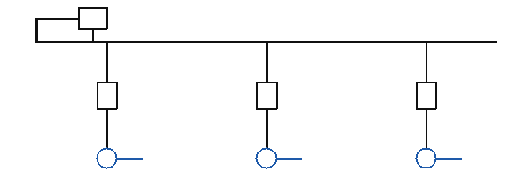

# 电力工程材料统计——转换样例

这份 .md 是 md2docx 的**回归样例**：五种块级结构、行内与块级公式、表格单元格里的公式、
中文标点与英文混排都在这里。转出来的 `demo.docx` 用来核对字号、字体、居中与原生公式对象。

## 1. 正文与行内公式

导线截面按下式选择，其中 \(I_{max}\) 是最大持续工作电流，\(J\) 是经济电流密度：

选择结果应满足 $S \geq \dfrac{I_{max}}{J}$，且不小于机械强度要求的最小截面 $S_{min}$。

电压损失按 $\Delta U\% = \dfrac{P R + Q X}{U_N^2} \times 100$ 估算；
短路电流周期分量的起始值记作 $I''$，冲击系数取 $K_{sh} = 1.8$。

绝对值与范数这类写法必须原样进公式，不能被竖线切成表格列：$|x| + |y| \le d$。

## 2. 块级公式

下面两条是显示式，转成 Word 后应当**独占一段并居中**：

$$P_{\Sigma} = \sum_{i=1}^{n} K_i P_i$$

\[
\Delta P_{loss} = 3 I_{c}^{2} R_{L} \, t \times 10^{-3} \quad (\mathrm{kWh})
\]

矩阵与分段函数也走同一条路：

$$\mathbf{Z} = \begin{bmatrix} R & X \\ -X & R \end{bmatrix}, \qquad
K_{\Sigma} = \begin{cases} 0.9, & n \le 3 \\ 0.8, & n > 3 \end{cases}$$

## 3. Markdown 表格

### 3.1 基本表

| 材料名称 | 型号规格 | 单位 | 单重（kg） | 数量 |
| --- | --- | :-: | --: | --: |
| 钢芯铝绞线 | LGJ-240/30 | m | 0.976 | 1250 |
| 复合悬式绝缘子 | FXBW4-15/70 | 只 | 12.5 | 48 |
| 真空断路器 | ZW32-12/630 | 台 | 85 | 6 |

标题行需要重复，数字列按 `--:` 右对齐，`:-:` 那一列居中。

### 3.2 单元格里的公式

| 项目 | 计算式 | 结果 |
| --- | --- | --- |
| 允许载流量 | $I = \sqrt{\dfrac{\Delta \theta}{R_{90} + R_{L}}}$ | 645 A |
| 电压偏差 | $\varepsilon = \dfrac{U - U_N}{U_N} \times 100\%$ | +2.1% |
| 经济电流 | $J = f(t,\,\beta)$ | 1.1 A/mm² |
| 综合单价 | 见 $\text{BOQ}_{i}$ 那一版 | 3654.12 元 |

表格里出现显示式公式时，**这一格内**独占一段并居中，不能跑到表外面去
（夹在句子里的 `$$…$$` 按行内处理，所以这一格写的是 `\[…\]`）：

| 名称 | 表达式 |
| --- | --- |
| 线损率 | \[ \eta = \dfrac{\Delta A}{A} \times 100\% \] |
| 需用系数 | $K_x = \dfrac{P_{js}}{P_e}$ |

## 4. 列表

- 材料申报按五个专业分册
  - 架空线路
  - 配电室
    - 高低压柜
    - 母线槽
- 绝缘子需要复检

1. 建立批次
2. 建立子项目
3. 场景挂组件后「生成物料清单」

任务清单：

- [x] 解析器与公式转换层
- [ ] Word 生成层

## 5. 代码与引用

行内代码 `--xslt-path` 用来手工指定样式表；命令是：

```bash
python md2docx.py samples/demo.md out/demo.docx --body-font 宋体 --body-size 12
```

> 已发布的清单不得更改。
> 据实调整发生在工程清单的行上，字典那一行永远不动。

## 6. 链接与图片

参考 [广东电网 20kV 及以下配电网建设项目扩大工程量清单（2025 年版）](https://example.com/boq.pdf "文件名带 . 也不该被切开")。



这一条的地址指向一个**不存在**的文件，Word 里应当留一句带查过的位置的话：


这一条是**远程地址**，本工具不去取，同样留一句说明它是远程的：


---

## 7. 会转失败的公式

下面这条 LaTeX 是故意写坏的（`\begin{array}` 缺列声明），转换应当**退回原文并标黄**，
其余公式照常出表：

$$\begin{array}{l}\text{这一条是好的}\end{array} \qquad \frac{1}{\text{bad} } \unknowncommand{x}$$

正文里同理：$\foo \bar$ 认不出来，就按原文写。
